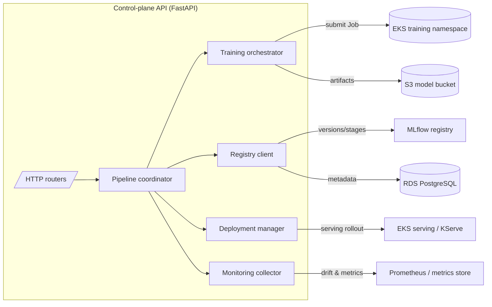

# Architecture

The Enterprise MLOps Platform is a control-plane that coordinates the model
lifecycle across four stages — **train, register, deploy, monitor** — on top of
AWS (EKS, S3, ECR, RDS). The control-plane itself is a stateless FastAPI service
deployed to Kubernetes via Helm.

## Component overview

## Request lifecycle

1. A client (or scheduler) calls `POST /training/jobs` or drives the full
   `MLOpsPipeline.run()` path.
2. `TrainingOrchestrator` renders and submits a batch job to the training
   namespace, writing artifacts to the S3 model bucket.
3. On success `ModelRegistryClient` registers a new `ModelVersion` and, when the
   evaluation metrics clear thresholds, transitions it to `Production`.
4. `DeploymentManager` rolls the version out to the serving layer using a
   rolling, canary, or blue/green strategy.
5. `MonitoringCollector` evaluates drift (PSI) and serving accuracy against the
   configured thresholds and returns a health verdict.

## Infrastructure

| Layer            | Service                    | Terraform                      |
| ---------------- | -------------------------- | ------------------------------ |
| Compute          | Amazon EKS                 | `terraform/modules/eks`        |
| Model storage    | Amazon S3 (models)         | `terraform/modules/storage`    |
| Artifact storage | Amazon S3 (artifacts)      | `terraform/modules/storage`    |
| Image registry   | Amazon ECR                 | `terraform/modules/storage`    |
| Metadata         | Amazon RDS (PostgreSQL)    | `terraform/main.tf`            |

## Configuration

All runtime configuration is supplied via `MLOPS_*` environment variables (see
`.env.example`) and surfaced in Kubernetes through the chart's ConfigMap and
Secret. Secrets are never committed; supply them through a secret manager or CI.
